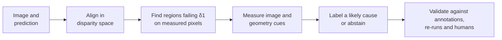

<div align="center">

# Vision Error Observatory

**Find where monocular depth models fail, and test why.**

[](https://github.com/Md-Zeeshan-Ali/vision-error-observatory/actions/workflows/ci.yml)
[](pyproject.toml)
[](LICENSE)

**Live explorer:** [vision-error-observatory.netlify.app](https://vision-error-observatory.netlify.app/)

</div>

A depth model can score well on average and still fail badly in specific places. VEO audits any monocular depth model: it locates the regions where predictions fail, describes each one with measurable cues, names a likely cause or abstains, and tests those explanations by editing images and re-running the model.

## How it works



**Labels:** `boundary_mixing`, `thin_object`, `textureless`, `reflection`, `poor_lighting`, or `ambiguous` when the evidence is weak. A region can carry several labels. The first four come from small logistic models fitted on the NYU train split; `poor_lighting` is a hand-set rule because no annotation exists to fit it against.

## Results

All results are from the official NYU Depth V2 test split (654 images, errors on sensor-measured pixels only) unless noted. Every number below comes from the files in [`results/`](results/), and a test checks the tables against them.

### Do the labels work?

AUROC against object annotations, where 0.5 is chance. The label model was fitted on NYU train and never saw Hypersim or iBims-1, which makes them the clean checks. NYU test results motivated this version of the labels, so they are not confirmatory.

| Label | NYU test | Hypersim | iBims-1 | Verdict |
|---|---|---|---|---|
| `boundary_mixing` | 0.85 | 0.81 | 0.69 | Holds up, though weaker on iBims-1 |
| `thin_object` | 0.73 | 0.81 | — | Holds up where it can be tested |
| `reflection` | 0.83 | 0.39 | 0.82 | Depends on sensor holes, which alone score 0.83 on iBims-1 |
| `textureless` | 0.58 | 0.50 | — | Close to chance |

<sub>— means iBims-1 can't test the label: it has no thin-object annotation, and only 3 regions fall on its wall masks. It uses transparent surfaces for `reflection` and annotated depth edges for `boundary_mixing`.</sub>

### Are the labels more than their cues?

These checks were added after the results above, in response to review, so they are exploratory ([results](results/review_checks.json)). Depth Anything V2 Small on NYU test unless noted.

| Label | Label model AUROC | Best single cue | Top-label precision | Fail-rate ratio | Failing pixels left at 2 px |
|---|---|---|---|---|---|
| `boundary_mixing` | 0.85 | 0.85 (depth-edge share) | 0.68 | 6.2× | 34% |
| `thin_object` | 0.73 | 0.66 (thin-structure share) | 0.24 | 2.2× | 29% |
| `textureless` | 0.58 | 0.59 (region size) | 0.14 | 0.44× | 93% |
| `reflection` | 0.83 | 0.76 (sensor holes) | 0.23 | 10.6× | 94% |

<sub>Fail-rate ratio: how many times more often silver-positive pixels fail than other annotated pixels. Left at 2 px: the share of labelled failing pixels that still fail when any prediction within 2 px may match the measured depth.</sub>

- **One cue does about as well.** Each label model barely beats its best single cue. On iBims-1, depth step alone scores 0.68 for boundaries, against 0.69 for the label model.
- **Only boundaries are usually right as a top label**, with precision 0.68 on NYU and 0.65 on iBims-1.
- **Walls and ceilings fail less often than other annotated pixels**, so `textureless` does not even pick out a high-risk surface.
- **Most boundary failures are an edge placed a pixel or two off.** With a 2 px tolerance, 34% of boundary-labelled failing pixels remain, against 85% of failing pixels away from silver boundaries (49% against 92% for DPT-Hybrid). The offset may be in the model or in the registration of image and sensor.
- **The rising boundary share is mostly mechanical.** Better models have a larger boundary share of failure-region pixels, but boundary failure as a share of all valid pixels barely moves with overall failure on NYU and DIODE (Spearman ρ = −0.12 and 0.02): other errors shrink around a nearly constant boundary floor. On iBims-1 it does move (ρ = 0.90).

### Do people agree with the labels?

Five raters labelled 300 test regions blind to VEO's output, using the [pre-registered protocol](docs/HUMAN_STUDY_PROTOCOL.md). Three are co-authors, and two (R4 and R5) are from outside the project. R4 and R5 were added after the first analysis, and every set is reported ([results](results/nyu_test/depth-anything-v2-small-hf/human_study.json), [ratings](results/nyu_test/depth-anything-v2-small-hf/human_study/)).

| Rater set | Rater agreement (Krippendorff's α) | VEO vs. human consensus (Cohen's κ) [95% CI] | Labels above chance |
|---|---|---|---|
| All five (primary) | 0.32 | 0.05 [−0.00, 0.11] | `textureless` |
| R3, R4, R5 | 0.48 | 0.04 [−0.01, 0.09] | `textureless` |
| R1, R2, R3 | 0.19 | 0.06 [0.02, 0.11] | `textureless` |

All three pre-registered checks fail in the primary analysis: raters agree only modestly (α below 0.4), VEO's labels do not beat always guessing the most common answer, and only one label is above chance. In the most consistent set, raters agree well enough (α 0.48), yet VEO still matches them at chance level. People find these causes hard to name, and VEO's labels do not capture what they see. `textureless`, the label that did worst against annotations, is the only one above chance against people.

### Do the explanations hold when the model is re-run?

Each labelled region is paired with a matched control and both get the same edit (120 pairs). A negative difference means the edit helped labelled regions more.

| Test | Difference in AbsRel [95% CI] | Holm p | Supports the label |
|---|---|---|---|
| Higher resolution, `boundary_mixing` | −0.009 [−0.016, −0.004] | 0.003 | Yes (exploratory) |
| Higher resolution, `thin_object` | −0.004 [−0.011, +0.003] | 0.63 | No |
| Brighten, `poor_lighting` | −0.007 [−0.020, +0.007] | 0.72 | No |
| Add texture, `textureless` | +0.014 [−0.019, +0.050] | 0.72 | No |

Separately, removing specular light from synthetic Hypersim renders shows that it does raise depth error: the more a region has, the more its error falls without it (Spearman ρ = −0.26, 95% CI [−0.36, −0.14]). This holds with each region's starting error held fixed (partial ρ = −0.24, 95% CI [−0.35, −0.10]).

### How do models compare?

| Model | NYU AbsRel | NYU δ1 | NYU failing pixels | DIODE AbsRel | iBims-1 AbsRel |
|---|---|---|---|---|---|
| Depth Anything V2 Large | 0.043 | 0.979 | 2.1% | 0.065 | 0.038 |
| Depth Pro | 0.043 | 0.979 | 2.1% | 0.064 | 0.037 |
| Depth Anything V2 Base | 0.046 | 0.977 | 2.3% | 0.068 | 0.041 |
| ZoeDepth NYU+KITTI* | 0.050 | 0.976 | 2.4% | 0.089 | 0.066 |
| Depth Anything V2 Small | 0.051 | 0.973 | 2.7% | 0.073 | 0.047 |
| Marigold† | 0.059 | 0.959 | 4.1% | 0.086 | 0.053 |
| DPT-Hybrid | 0.091 | 0.918 | 8.2% | 0.098 | 0.075 |
| DPT-Large | 0.092 | 0.915 | 8.5% | 0.096 | 0.071 |

<sub>*Trained on NYU, so its NYU row is not a fair comparison. †Diffusion model, run with 4 denoising steps and no ensembling, which is lighter than in its paper. It is aligned in depth space, and its fitted scale came out negative on 1 NYU and 13 DIODE frames. All models are evaluated after per-image alignment. DIODE: 325 indoor frames. iBims-1: 100 indoor images, keeping transparent surfaces, so its numbers can't be compared with published ones.</sub>

Paired tests with Holm correction, on NYU unless noted:

- **Size matters:** larger Depth Anything models reliably reduce AbsRel on NYU and iBims-1. On DIODE, neither step up in size reliably changes AbsRel.
- **Hybrid vs. pure ViT:** no reliable difference on any outcome between DPT-Hybrid and DPT-Large, on any of the three datasets.
- **Diffusion:** Depth Anything V2 Small has lower AbsRel than Marigold on NYU and DIODE, with no reliable difference on iBims-1.
- **Family:** DPT-Hybrid fails on about three times as many pixels as Depth Anything V2 Small, largely in regions labelled `textureless`. Training data differs too, so this can't be attributed to architecture.

### Do models have a failure "fingerprint"?

The original study claimed that ViT and convolutional models have distinct failure fingerprints. The rule was set before these results: a label counts only if its share of a model's failing regions differs reliably, in the same direction, on NYU, DIODE and iBims-1 ([decision](results/fingerprint_decision.json)).

- **Backbone (DPT-Hybrid vs. DPT-Large):** no label passes, so the architecture claim is **cut**.
- **Family (Depth Anything V2 Small vs. DPT-Hybrid):** only `textureless` passes, with a larger share for DPT-Hybrid (−0.29 on NYU, −0.12 on DIODE, −0.25 on iBims-1). That label scores close to chance against annotations, so this is a difference in VEO's labels, not an established difference in failure type.

### Can the diagnosis improve a model?

Fine-tuning Depth Anything V2 Small's decoder on NYU train, up-weighting the regions VEO diagnosed, does **not** help. Rules were written before test scoring, with three seeds per condition. Error is measured on annotated pixels rather than VEO's labels, and a negative difference would mean the diagnosis helped.

| Up-weighted regions | Measured on | VEO-guided | Random control | Difference [95% CI] | Supported |
|---|---|---|---|---|---|
| `boundary_mixing` | Occluding boundaries | 0.113 | 0.093 | +0.020 [+0.018, +0.022] | No |
| `textureless` | Walls and ceilings | 0.048 | 0.044 | +0.003 [+0.002, +0.005] | No |

Both VEO-guided conditions were worse on their targets and overall, in all three seeds. Plain fine-tuning with no weighting improved AbsRel from 0.051 to 0.046, and random up-weighting changed it little. The weighting did act on the training images: at seed 0, `boundary_mixing` up-weighting cut error on its targeted training regions from 0.31 to 0.17, so the failure is best explained by fitting those specific regions rather than learning anything general.

The test above gives the targeted pixels 20% of the loss. To check whether a gentler weight helps, and whether the label adds anything beyond "this region failed", an [amendment](docs/FINETUNE_PROTOCOL.md) fixed before any of these runs repeated it at 5% and 10%, and added a baseline that up-weights every failure region whatever its label ([results](results/finetune/weight_sweep.json)).

| Comparison | Measured on | Difference [95% CI] | Holm p | Supported |
|---|---|---|---|---|
| VEO vs. random, 5% | Occluding boundaries | +0.0053 [+0.0038, +0.0067] | 0.0004 | No |
| VEO vs. random, 10% | Occluding boundaries | +0.0114 [+0.0096, +0.0133] | 0.0004 | No |
| VEO vs. random, 5% | Walls and ceilings | +0.0003 [−0.0003, +0.0009] | 0.34 | No |
| VEO vs. random, 10% | Walls and ceilings | +0.0010 [−0.0003, +0.0022] | 0.25 | No |
| VEO vs. all failures, 20% | Occluding boundaries | +0.0180 [+0.0167, +0.0193] | 0.0002 | No |
| VEO vs. all failures, 20% | Walls and ceilings | +0.0013 [+0.0008, +0.0018] | 0.0002 | No |

No strength helps. On boundaries the harm shrinks with the weight (+0.020 at 20%, +0.011 at 10%, +0.005 at 5%) but stays reliable, and on walls and ceilings the weaker weights make no reliable difference. Up-weighting every failure region was itself worse than plain fine-tuning (+0.0015 overall AbsRel), so neither the diagnosis nor the failure mask is a useful training signal here. All runs use one model and one dataset.

## Quick start

Requires [uv](https://github.com/astral-sh/uv).

```bash
git clone https://github.com/Md-Zeeshan-Ali/vision-error-observatory.git
cd vision-error-observatory
uv sync --extra dev
python web_app/fetch_assets.py    # video and scene data used by the web tests
uv run python -m pytest -q

# The whole pipeline on a small synthetic dataset: no downloads or GPU
uv run python -m veo.cli reproduce --fixture --workdir /tmp/veo
```

## Reproduce the results

Needs a GPU for reasonable speed, about 25 GB of disk space, and the `model` extra.

```bash
uv sync --extra dev --extra model
uv run python -m veo.cli download-nyu

uv run python -m veo.cli reproduce --device cuda \
  --models depth-anything/Depth-Anything-V2-Small-hf Intel/dpt-hybrid-midas \
  --extra-models depth-anything/Depth-Anything-V2-Base-hf depth-anything/Depth-Anything-V2-Large-hf \
                 Intel/dpt-large Intel/zoedepth-nyu-kitti apple/DepthPro-hf prs-eth/marigold-depth-v1-1

uv run python experiments/hypersim_reflection.py --device cuda --output results/hypersim/hypersim_reflection.json
uv run python experiments/external_diode.py --device cuda
uv run python experiments/external_ibims.py --device cuda

uv run python experiments/compare_models.py --root outputs/diode --output results/diode/model_comparison.json --scan-units
uv run python experiments/compare_models.py --root outputs/ibims --output results/ibims/model_comparison.json
uv run python experiments/fingerprint_decision.py
uv run python experiments/guided_finetune.py --device cuda
```

Summaries are written to `results/<dataset>/SUMMARY.md`. Runs resume after an interruption: run the same command again and it continues from its checkpoints. After changing code, add `--fresh`.

## Audit your own predictions

Save one `<image_id>.npy` per image, with the same height and width as the image, and write a config pointing at your images and depth (see [`configs/nyu.yaml`](configs/nyu.yaml)):

```bash
uv run python -m veo.cli run-precomputed --config my_config.yaml --prediction-dir my_predictions --output-dir outputs/my_model
```

The fitted labels expect indoor scenes. The `reflection` label also expects a Kinect-style depth sensor with missing readings.

## Explore in the browser

An interactive explorer of real test images and failure regions, plus a 3D walkthrough of how the model works. It is live at [vision-error-observatory.netlify.app](https://vision-error-observatory.netlify.app/); to run it locally:

```bash
python web_app/fetch_assets.py    # checksum-verified download
python web_app/serve.py           # or: docker compose up --build
```

## Human study

A blinded study of 300 regions is pre-registered and done; the results are [above](#do-people-agree-with-the-labels). To rebuild the package and rerun the analysis:

```bash
uv run python -m veo.cli prepare-study --results-path outputs/nyu_test/depth-anything-v2-small-hf/model_results.json \
  --train-results outputs/nyu_test/depth-anything-v2-small-hf/train/model_results.json --output-dir study
# Share study/ with raters; keep study_manifest.json private. Then:
uv run python experiments/human_study.py --manifest study_manifest.json --ratings ratings/*.json \n  --calibration results/nyu_test/depth-anything-v2-small-hf/silver_calibration.json --output results/nyu_test/depth-anything-v2-small-hf/human_study.json
```

## Limitations

- **Annotations are a proxy.** Wall and ceiling stand in for "textureless", and on average 42% of a region's pixels on NYU have no annotation at all.
- **Labels describe more than they explain.** Only one of four image-edit tests supported its label, and that one is exploratory. Up-weighting diagnosed regions in training made the model worse at every weight tried. Each label model does little better than its best single cue, and most boundary failures are an edge placed a pixel or two off. Against five human raters, VEO's labels agree at chance level.
- **The audit needs ground truth.** Finding failure regions and two of the label cues rely on measured depth.
- **Some failures may be sensor errors.** On reflective surfaces, predictions tend to be nearer than the sensor's reading, which may mean the sensor is wrong.
- **DIODE labels can't be checked.** It has no annotations, so it supports metrics and the fingerprint test only. Its tests use 10 scans from 3 scenes, which are not independent.
- **The human study has caveats.** Three of the five raters are co-authors, two raters were added after the first analysis, and the two outside raters rated quickly (about 4 seconds per region).
- **Not covered:** outdoor scenes. The labels were fitted on indoor data only.

## Repository

```text
src/veo/       library and CLI
experiments/   one script per reported result
configs/       settings and the fitted label model
results/       committed results, each with provenance
docs/          protocols and rater guideline
tests/         test suite
web_app/       browser explorer
scripts/site/  builders for the web app and video
```

## Documentation

| Document | Contents |
|---|---|
| [Research protocol](docs/RESEARCH_PROTOCOL_V2.md) | Data, splits, failure rule and amendments |
| [Label model](docs/LABEL_MODEL_V3.md) | How the labels were fitted, and amendments |
| [Intervention tests](docs/INTERVENTION_PROTOCOL.md) | Image-edit and Hypersim test designs |
| [Model comparison](docs/MODEL_COMPARISON_PROTOCOL.md) | Contrasts, statistics and external checks |
| [Guided fine-tuning](docs/FINETUNE_PROTOCOL.md) | Whether the diagnosis can improve a model |
| [Human study](docs/HUMAN_STUDY_PROTOCOL.md) · [Rater guideline](docs/RATER_GUIDELINE.md) | Pre-registered analysis and rater instructions |
| [v1 results](docs/V1_RESULTS.md) · [v1 errata](docs/ERRATA_V1.md) | The original study and what was corrected |

## License

[MIT](LICENSE)
