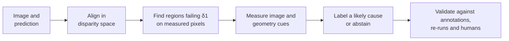

<div align="center">

# Vision Error Observatory

**Find where monocular depth models fail, and test why.**

[](https://github.com/MdZeeshanAli01/VEO_V2/actions/workflows/ci.yml)
[](pyproject.toml)
[](LICENSE)

</div>

A depth model can score well on average and still fail badly in specific places. VEO audits any monocular depth model: it locates the regions where predictions fail, describes each one with measurable cues, names a likely cause or abstains, and tests those explanations by editing images and re-running the model.

## How it works



**Labels:** `boundary_mixing`, `thin_object`, `textureless`, `reflection`, `poor_lighting`, or `ambiguous` when the evidence is weak. A region can carry several labels. The first four come from small logistic models fitted on the NYU train split; `poor_lighting` is a hand-set rule because no annotation exists to fit it against.

## Results

All results are from the official NYU Depth V2 test split (654 images, errors on sensor-measured pixels only) unless noted. Every number below comes from the files in [`results/`](results/), and a test checks the tables against them.

### Do the labels work?

AUROC against object annotations, where 0.5 is chance. The label model was fitted on NYU train and never saw Hypersim, which makes Hypersim the clean check. NYU test results motivated this version of the labels, so they are not confirmatory.

| Label | NYU test | Hypersim | Verdict |
|---|---|---|---|
| `boundary_mixing` | 0.85 | 0.81 | Holds up across datasets |
| `thin_object` | 0.73 | 0.81 | Holds up |
| `reflection` | 0.83 | 0.39 | Kinect only: it relies on nearby sensor holes |
| `textureless` | 0.58 | 0.50 | Close to chance |

### Do the explanations hold when the model is re-run?

Each labelled region is paired with a matched control and both get the same edit (120 pairs). A negative difference means the edit helped labelled regions more.

| Test | Difference in AbsRel [95% CI] | Holm p | Supports the label |
|---|---|---|---|
| Higher resolution, `boundary_mixing` | −0.009 [−0.016, −0.004] | 0.003 | Yes (exploratory) |
| Higher resolution, `thin_object` | −0.004 [−0.011, +0.003] | 0.63 | No |
| Brighten, `poor_lighting` | −0.007 [−0.020, +0.007] | 0.72 | No |
| Add texture, `textureless` | +0.014 [−0.019, +0.050] | 0.72 | No |

Separately, removing specular light from synthetic Hypersim renders shows that it does raise depth error: the more a region has, the more its error falls without it (Spearman ρ = −0.26, 95% CI [−0.36, −0.14]).

### How do models compare?

| Model | NYU AbsRel | NYU δ1 | NYU failing pixels | DIODE AbsRel |
|---|---|---|---|---|
| Depth Anything V2 Large | 0.043 | 0.979 | 2.1% | 0.065 |
| Depth Pro | 0.043 | 0.979 | 2.1% | 0.064 |
| Depth Anything V2 Base | 0.046 | 0.977 | 2.3% | 0.068 |
| ZoeDepth NYU+KITTI* | 0.050 | 0.976 | 2.4% | 0.089 |
| Depth Anything V2 Small | 0.051 | 0.973 | 2.7% | 0.073 |
| DPT-Hybrid | 0.091 | 0.918 | 8.2% | 0.098 |
| DPT-Large | 0.092 | 0.915 | 8.5% | 0.096 |

<sub>*Trained on NYU, so its NYU row is not a fair comparison. All models are evaluated after per-image alignment. DIODE: 325 indoor frames.</sub>

Scene-level paired tests with Holm correction, on NYU:

- **Size matters:** larger Depth Anything models reliably reduce AbsRel.
- **Hybrid vs. pure ViT:** no reliable difference on any outcome between DPT-Hybrid and DPT-Large.
- **Family:** DPT-Hybrid fails on about three times as many pixels as Depth Anything V2 Small, largely in regions labelled `textureless`. Training data differs too, so this can't be attributed to architecture.

## Quick start

Requires [uv](https://github.com/astral-sh/uv).

```bash
git clone https://github.com/MdZeeshanAli01/VEO_V2.git
cd VEO_V2
uv sync --extra dev
python web_app/fetch_assets.py    # video and scene data used by the web tests
uv run python -m pytest -q

# The whole pipeline on a small synthetic dataset: no downloads or GPU
uv run python -m veo.cli reproduce --fixture --workdir /tmp/veo
```

## Reproduce the results

Needs a GPU for reasonable speed, about 20 GB of disk space, and the `model` extra.

```bash
uv sync --extra dev --extra model
uv run python -m veo.cli download-nyu

uv run python -m veo.cli reproduce --device cuda \
  --models depth-anything/Depth-Anything-V2-Small-hf Intel/dpt-hybrid-midas \
  --extra-models depth-anything/Depth-Anything-V2-Base-hf depth-anything/Depth-Anything-V2-Large-hf \
                 Intel/dpt-large Intel/zoedepth-nyu-kitti apple/DepthPro-hf

uv run python experiments/hypersim_reflection.py --device cuda --output results/hypersim/hypersim_reflection.json
uv run python experiments/external_diode.py --device cuda
```

Summaries are written to `results/<dataset>/SUMMARY.md`. Runs resume after an interruption: run the same command again and it continues from its checkpoints. After changing code, add `--fresh`.

## Audit your own predictions

Save one `<image_id>.npy` per image, with the same height and width as the image, and write a config pointing at your images and depth (see [`configs/nyu.yaml`](configs/nyu.yaml)):

```bash
uv run python -m veo.cli run-precomputed --config my_config.yaml --prediction-dir my_predictions --output-dir outputs/my_model
```

The fitted labels expect indoor scenes. The `reflection` label also expects a Kinect-style depth sensor with missing readings.

## Explore in the browser

An interactive explorer of real test images and failure regions, plus a 3D walkthrough of how the model works.

```bash
python web_app/fetch_assets.py    # checksum-verified download
python web_app/serve.py           # or: docker compose up --build
```

## Human study

A blinded study of 300 regions is built and pre-registered, and **still needs raters**.

```bash
uv run python -m veo.cli prepare-study --results-path outputs/nyu_test/depth-anything-v2-small-hf/model_results.json \
  --train-results outputs/nyu_test/depth-anything-v2-small-hf/train/model_results.json --output-dir study
# Share study/ with raters; keep study_manifest.json private. Then:
uv run python experiments/human_study.py --manifest study_manifest.json --ratings ratings/*.json --output results/nyu_test/human_study.json
```

## Limitations

- **Annotations are a proxy.** Wall and ceiling stand in for "textureless", and on average 42% of a region's pixels on NYU have no annotation at all.
- **Labels describe more than they explain.** Only one of four image-edit tests supported its label, and that one is exploratory.
- **The audit needs ground truth.** Finding failure regions and two of the label cues rely on measured depth.
- **Some failures may be sensor errors.** On reflective surfaces, predictions tend to be nearer than the sensor's reading, which may mean the sensor is wrong.
- **DIODE labels are uninformative.** The label mix is nearly identical for every model there, so only its metrics are reported above.
- **Not covered:** outdoor scenes, and iBims-1, which could not be downloaded.

## Repository

```text
src/veo/       library and CLI
experiments/   one script per reported result
configs/       settings and the fitted label model
results/       committed results, each with provenance
docs/          protocols and rater guideline
tests/         test suite
web_app/       browser explorer
scripts/site/  builders for the web app and video
```

## Documentation

| Document | Contents |
|---|---|
| [Research protocol](docs/RESEARCH_PROTOCOL_V2.md) | Data, splits, failure rule and amendments |
| [Label model](docs/LABEL_MODEL_V3.md) | How the labels were fitted, and amendments |
| [Intervention tests](docs/INTERVENTION_PROTOCOL.md) | Image-edit and Hypersim test designs |
| [Model comparison](docs/MODEL_COMPARISON_PROTOCOL.md) | Contrasts, statistics and external checks |
| [Human study](docs/HUMAN_STUDY_PROTOCOL.md) · [Rater guideline](docs/RATER_GUIDELINE.md) | Pre-registered analysis and rater instructions |
| [v1 results](docs/V1_RESULTS.md) · [v1 errata](docs/ERRATA_V1.md) | The original study and what was corrected |

## Authors

Anshuman Chakravorty, Zeeshan Ali and Omer Faraz, with faculty mentors Prof. Anshi Bajaj and Dr. Amit Saini, School of Technology Management and Engineering, SVKM's NMIMS University, Hyderabad.

```bibtex
@software{chakravorty2026veo,
  title  = {Vision Error Observatory: Failure Analysis for Monocular Depth Estimation},
  author = {Chakravorty, Anshuman and Ali, Zeeshan and Faraz, Omer},
  year   = {2026},
  url    = {https://github.com/MdZeeshanAli01/VEO_V2}
}
```

## License

[MIT](LICENSE)
